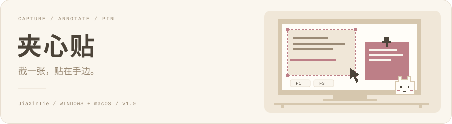
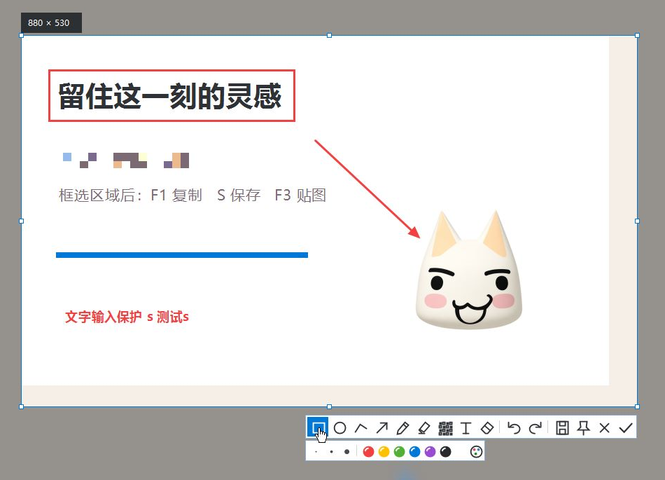

  <picture>
    <source media="(prefers-color-scheme: dark)" srcset="assets/readme-cover-dark.svg" />
    
  </picture>

  <strong>把想留住的画面，贴在手边。</strong> 
  一个安静的截图、标注与桌面贴图小工具。Windows 和 Mac，都可以。

  <a href="https://github.com/Jesseovo/jiaxintie/releases/download/v1.0/JiaXinTie-Windows-x64-v1.0.zip"><picture>
    <source media="(prefers-color-scheme: dark)" srcset="assets/readme-windows-dark.svg" />
    
  </picture></a>&ensp;<a href="https://github.com/Jesseovo/jiaxintie/releases/download/v1.0/JiaXinTie-macOS-universal-v1.0.zip"><picture>
    <source media="(prefers-color-scheme: dark)" srcset="assets/readme-macos-dark.svg" />
    
  </picture></a>

  <a href="https://jesseovo.github.io/jiaxintie/">产品官网</a> · <a href="docs/ABOUT.md">关于夹心贴</a> · <a href="https://github.com/Jesseovo/jiaxintie/releases/tag/v1.0">v1.0 发布页</a> · <a href="docs/usage.zh-CN.md">使用手册</a> · <a href="CHANGELOG.md">更新记录</a> · <a href="docs/development.md">参与开发</a>

---

## 先把它放在手边

下载适合你电脑的版本，解压后就可以开始。

| 你的电脑 | 下载内容 | 怎么打开 |
|---|---|---|
| Windows 10 / 11，64 位 | [Windows v1.0](https://github.com/Jesseovo/jiaxintie/releases/download/v1.0/JiaXinTie-Windows-x64-v1.0.zip) | 运行安装程序，或直接打开 `夹心贴.exe` |
| macOS 14 及以上 | [macOS v1.0](https://github.com/Jesseovo/jiaxintie/releases/download/v1.0/JiaXinTie-macOS-universal-v1.0.zip) | 把 `夹心贴.app` 放进“应用程序”再打开；支持 Apple Silicon 和 Intel |

Windows 版在系统托盘，Mac 版在屏幕顶部菜单栏。首次打开，选好截图保存文件夹就行。Mac 首次截图需要允许屏幕录制权限；当前 Mac 包使用临时签名，尚未经过 Apple 公证。具体步骤见[使用手册](docs/usage.zh-CN.md#安装与启动)。

## 截下来，轻轻贴住

看到想留住的参考图、临时要对照的文字，或者一闪而过的小灵感，不必先给它找一个归处。

**截一张。** 按 F1，拖动鼠标选中想要的部分，再按一次 F1，图片就复制好了。需要存下来时，按 S，直接写进你选好的文件夹。

**贴在旁边。** 按 F3，把剪贴板里的图片贴到桌面。拖到顺手的位置，滚动缩放，和正在做的事情放在一起看。暂时不需要时，隐藏或删除这一张贴图就好。

**继续手头的事。** 夹心贴留在托盘或菜单栏里，不需要登录，也没有广告和联网请求。截图、标注、保存，都在你的电脑上完成。

## 记住三个键就够了

| 按键 | 做什么 |
|---|---|
| **F1** | 开始截图；框选后再按一次，完成复制 |
| **F3** | 贴图 |
| **S** | 保存截图 |
| Esc | 取消截图，或删除当前贴图 |

Mac 的 F 键如果默认控制亮度、音量，配合 **Fn** 使用。所有操作也能通过菜单和工具栏点击完成；按键可以在设置中修改，更多操作收在[快捷键说明](docs/usage.zh-CN.md#快捷键)里。

## 一点标注，刚刚好

圈出重点，加一个箭头，写一句话，或者把不想露出的部分打上马赛克。矩形、圆形、直线、箭头、画笔、荧光笔、马赛克、文字和橡皮擦，都放在选区旁边。画错了，撤销一下再来。

  

Windows 演示画面。Mac 使用原生界面，操作保持一致。

输入标注文字时，截图快捷键会暂时让开。中文可以慢慢写，S 也只是一个字母，不会把还没写完的截图保存掉。

## 你的截图，留在你的电脑里

手动保存的图片长期保留，自动缓存只留最近三张。第四张完成后，程序只会轮换自己生成的缓存，不清理其他图片。换一个保存文件夹，旧目录里的内容也会留下。

贴图可以随时关闭，已保存的图片和最近截图不会跟着消失。需要找回来时，从菜单里的“最近截图”再贴一次。

当前版本专注区域截图、基础标注和桌面贴图。OCR、滚动长截图、自动窗口识别还没有加入；Mac 单次选区位于一块显示器内。已验证的范围和限制写在[验证记录](VALIDATION.md)里。

## 再往里看看

[产品官网](https://jesseovo.github.io/jiaxintie/) — 产品展示和可直接下载的双平台安装包。 
[关于夹心贴](docs/ABOUT.md) — 产品定位、适用场景、功能、隐私和版本边界。 
[使用手册](docs/usage.zh-CN.md) — 安装、权限、完整快捷键、保存位置和常见问题。 
[开发说明](docs/development.md) — Windows / macOS 源码、构建、测试和打包。 
[验证记录](VALIDATION.md) · [更新记录](CHANGELOG.md) · [反馈问题](https://github.com/Jesseovo/jiaxintie/issues)

## 慢慢攒起的小星光

如果这个小工具替你留住了一点灵感，欢迎[点一颗 Star](https://github.com/Jesseovo/jiaxintie/stargazers)，也欢迎告诉我，下一次你想把什么贴在手边。

---

  Made to keep little moments, by <a href="https://github.com/Jesseovo">Jesse</a>. 
  截一张，贴在手边。

